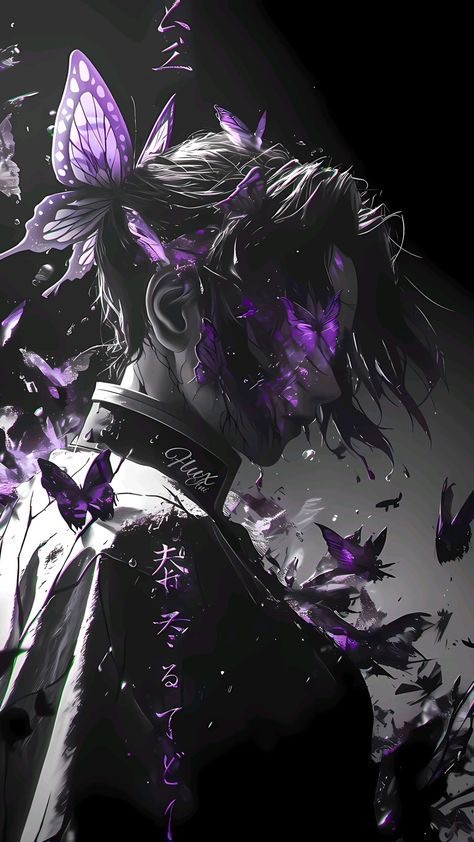

<!-- ============================================================
  README for vert_k  |  dark purple / terminal / anime theme
  Search for "EDIT" in this file to find things you can change.
============================================================ -->

<!-- HEADER BANNER -->
<p align="center">
  
</p>

<!-- TYPING ANIMATION -->
<p align="center">
  
</p>

<!-- ============================================================
  EDIT: YOUR IMAGE / GIF
  1) Upload your image or gif to this repo and name it hero.gif
  2) Change  hero-placeholder.svg  below to  hero.gif
============================================================ -->
<p align="center">
  
</p>

<br/>

<!-- ANIMATED TERMINAL SCREEN -->
<p align="center">
  
</p>

<br/>

<h2 align="center">⟨ 🌌 about.js ⟩</h2>

```js
// ✦ ─────────────────────────────────── ✦
const vert_k = {
  codename : "vert_k",
  role     : "Full-Stack Web Developer",
  studying : ["Networking", "TCP/IP", "Linux"],
  mission  : "Build things that feel like magic ✨",
  vibe     : ["dark mode", "purple neon", "anime", "late-night code"],
  status   : "ONLINE 🟣",
  contact  : { discord: "vert_k", telegram: "@vert_49" },
};
// ✦ ─────────────────────────────────── ✦
```

<h2 align="center">⟨ ⚡ skills.loadout() ⟩</h2>

<!-- EDIT: add or remove badges to match your real stack -->
<p align="center">
  
  
  
  
  
  
  
  
  
</p>

<h2 align="center">⟨ 📡 connect --open ⟩</h2>

<p align="center">
  
  &nbsp;
  <a href="https://t.me/vert_49">
    
  </a>
</p>

```bash
$ ./contact --list
  discord   >>  vert_k
  telegram  >>  @vert_49      # t.me/vert_49
$ _
```

<h2 align="center">⟨ 📊 stats.sys ⟩</h2>

<!-- ============================================================
  EDIT: replace YOUR_GITHUB_USERNAME (2 places below) with your real GitHub username
============================================================ -->
<p align="center">
  
  
</p>

<br/>

<p align="center"><i>「 Code is just magic you can debug. 」 ✦</i></p>

<!-- FOOTER WAVE -->
<p align="center">
  
</p>
